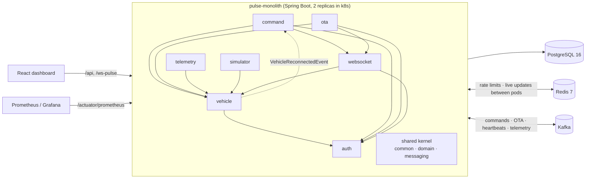

# Pulse — Connected Vehicle & Fleet OTA Platform

[](https://oracle.com/java/)
[](https://spring.io/projects/spring-boot)
[](https://spring.io/projects/spring-modulith)
[](https://react.dev/)
[](https://www.typescriptlang.org/)
[](https://vitejs.dev/)
[](https://kafka.apache.org/)
[](https://kubernetes.io/)
[](https://www.postgresql.org/)
[](https://redis.io/)
[](https://prometheus.io/)
[](https://grafana.com/)
[](https://github.com/basarsy/pulse/actions/workflows/ci.yml)

**Pulse** is a connected vehicle and fleet OTA update platform (BMW-inspired). It combines **Remote Vehicle Services** (real-time vehicle status and remote commands over asynchronous channels), **Fleet OTA Update Management** (software releases, staged canary rollouts, and automatic pausing when too many updates fail), **Telemetry & Observability** (vehicle health ingestion, audit logging, circuit breakers, Prometheus/Grafana), and a **Fleet Dashboard** built with React & TypeScript.

---

## 🏗️ Architecture: a modular monolith

Pulse is a single deployable Spring Boot application (`pulse-monolith`) organised into **domain modules**. Module boundaries are enforced by [Spring Modulith](https://spring.io/projects/spring-modulith): `ModularityTests` fails the build on dependency cycles between modules or on access to another module's internal packages.

| Module | Responsibility |
|---|---|
| `auth` | Users, roles, JWT issuance/validation, HTTP security configuration |
| `vehicle` | Vehicle registry, ownership & access policy, connectivity (heartbeats) |
| `command` | Remote command lifecycle, idempotency & rate limiting, Kafka dispatch, WebSocket push |
| `ota` | Software versions, staged rollout campaigns, per-vehicle update tracking |
| `telemetry` | Telemetry ingestion and history |
| `simulator` | Optional vehicle simulator (heartbeats, command/OTA execution, telemetry) |
| `common`, `domain`, `messaging`, `config` | Shared kernel: audit log, error handling, domain enums, Kafka topics & event payloads |
| `websocket` | STOMP broker, subscription authorisation, live updates shared between pods over Redis pub/sub |

Each module owns its Kafka producers/consumers and WebSocket notifications. Where a dependency would point "backwards", modules communicate through Spring application events. For example, `vehicle` publishes `VehicleReconnectedEvent` and `command` flushes queued commands in response.



`mvn verify` also generates PlantUML diagrams of the actual module graph in `pulse-monolith/target/spring-modulith-docs`.

> An earlier iteration split the system into microservices (vehicle-registry, command, OTA, gateway). It was removed in favour of this modular monolith: the services duplicated most of the monolith's code and were never deployable end-to-end. The enforced module boundaries keep the option open to extract a service later.

---

## 🧭 Design decisions

Each decision below lists the problem, what Pulse does, what was ruled out, and the test that proves it. Design docs for every change since the command lifecycle work (PR #4) are in [`docs/superpowers/specs/`](docs/superpowers/specs/).

Most of them show up on the path of a single remote command. In Kubernetes, the request, the Kafka result and the browser's WebSocket can each land on a different pod:

```mermaid
sequenceDiagram
    autonumber
    participant B as Browser
    participant A as Pod handling the request
    participant DB as PostgreSQL
    participant K as Kafka
    participant V as Vehicle
    participant C as Pod consuming the result
    participant R as Redis
    participant S as Pod holding the browser's WebSocket
    B->>A: POST /api/v1/vehicles/{id}/commands
    A->>DB: one transaction: command row + outbox row (online vehicle; offline ones wait in PENDING)
    A-->>B: 202 Accepted
    A->>K: after commit: vehicle.commands (retried until delivered)
    K->>V: command
    V->>K: vehicle.command-results
    K->>C: result (retried with backoff, then to the dead-letter topic)
    C->>DB: forward-only status change
    C->>R: live update, queued for a background sender
    R->>S: live update
    S->>B: STOMP /topic/vehicles/{id}/commands
```

### 1. Kafka sends go through a transactional outbox

- **Problem:** a command is saved in Postgres and sent to Kafka. Sending inside the transaction can send a command whose transaction then rolls back. Sending after the commit loses the command if Kafka is down at that moment.
- **Decision:**
  - The service publishes an event inside its transaction. Spring Modulith stores it in the `event_publication` table in that same transaction, and a listener sends it to Kafka only after the commit.
  - A scheduled job resubmits failed publications after a minute and purges completed ones after 7 days. Delivery is therefore at least once.
  - Incoming messages are retried with exponential backoff. Malformed ones go straight to `<topic>.DLT`, so no message is dropped silently.
- **Why not Kafka transactions:** they make Kafka writes atomic with each other, not with the Postgres write.
- **Proof:**
  - [`KafkaRoundTripTest`](pulse-monolith/src/test/java/com/pulse/connected/KafkaRoundTripTest.java) drives commands and a two-stage rollout through Kafka and the vehicle simulator, then checks that the outbox drains.
  - [`KafkaErrorHandlingTest`](pulse-monolith/src/test/java/com/pulse/connected/KafkaErrorHandlingTest.java) checks that malformed results land in the dead-letter topic.

### 2. The database enforces idempotency keys

- **Problem:** keys were checked in Redis, with a unique constraint in Postgres behind them. The two stores disagreed:
  - Two identical requests racing each other both missed in Redis, and the loser hit the constraint with a `500`.
  - After 24 hours Redis forgot the key but the constraint didn't, so a retry also got a `500`.
  - Retries used up the rate limit, and the same key with a different command type silently returned the earlier command.
- **Decision:**
  - A unique constraint on (issuer, idempotency key). The request that loses the race to insert reads the winner back and returns it, so a retry gets the original command instead of an error.
  - Keys never expire. Reusing a key for another vehicle or another command type returns a `409`.
  - Redis now does only rate limiting. A retry of a known key returns before the rate limit is checked, so it isn't counted; only the loser of a simultaneous race uses a slot.
- **Ruled out:**
  - `INSERT … ON CONFLICT`: it bypasses the JPA entity.
  - A Postgres advisory lock: an extra round trip on every command that has a key.
  - Keeping Redis with a reservation step: two stores that can disagree.
- **Proof:** [`IdempotencyRaceTest`](pulse-monolith/src/test/java/com/pulse/connected/IdempotencyRaceTest.java) fires 8 identical requests at once against real Postgres. One command is created, and all 8 responses carry its id.

### 3. Rollout progress is handled one event at a time per campaign

- **Problem:** progress events were handled on one thread, which doesn't scale with the fleet. With more threads, the last updates of a stage race each other: each transaction misses the others' updates, so the stage never advances, or two of them both start the next stage.
- **Decision:**
  - Progress events are consumed on 3 threads, one per partition.
  - Each event locks its campaign row (`SELECT … FOR UPDATE`) before reading the update. Events for one campaign run one after another, while different campaigns still run in parallel.
  - Each event costs a fixed number of queries: one count grouped by stage and status, instead of loading every update.
  - Status changes only move forward, so a late or duplicate event can't undo a finished update.
- **Ruled out:**
  - Optimistic retry on every event: constant retries under load, and events could use up their retries and end in the dead-letter topic.
  - Keying Kafka messages by campaign: vehicles would need to know their campaign, and one big rollout would be pinned to one thread.
- **Proof:** [`RolloutConcurrencyTest`](pulse-monolith/src/test/java/com/pulse/connected/ota/RolloutConcurrencyTest.java) fires the last 5 events of a stage in parallel against real Postgres. The stage advances exactly once, and stage 2 gets exactly 5 vehicles.

### 4. Each scheduled job runs once across replicas

- **Problem:** with 2 replicas, every `@Scheduled` job would run twice, and two outbox resubmission runs would send duplicate Kafka messages. That is why the app ran as a single replica until this change.
- **Decision:** [ShedLock](https://github.com/lukas-krecan/ShedLock), with the locks in Postgres and the database's clock. Each of the six jobs takes its lock row first, and a replica that finds the row taken skips that run.
- **Ruled out:**
  - Hand-written advisory locks: custom code instead of a well-known library.
  - Electing one leader instance: heavy for six small jobs, and a stuck leader stops all of them.
- **Proof:**
  - [`SchedulerLockTest`](pulse-monolith/src/test/java/com/pulse/connected/SchedulerLockTest.java) shows that a second run at the same time is skipped while the first holds the lock.
  - [`ScheduledJobLockCoverageTest`](pulse-monolith/src/test/java/com/pulse/connected/ScheduledJobLockCoverageTest.java) fails the build if a new `@Scheduled` method has no lock.

### 5. Live updates reach every pod, in the order each pod published them

- **Problem:** two separate bugs.
  - Each pod's STOMP broker is in memory, so an update reached only the browsers connected to the pod that handled the Kafka event.
  - Spring sends to each browser through a thread pool, so even on a single pod two updates could arrive swapped. A command could then show `SENT` after it was already `ACKNOWLEDGED`.
- **Decision:**
  - Every pod publishes its updates to a Redis channel, and delivers the other pods' updates to its own browsers one at a time.
  - Sending to Redis happens on a background thread with a bounded queue. If Redis is down or slow, updates for other pods are dropped and counted in `pulse.live.updates.forward.failed`, and the code that publishes them never waits for Redis. (Issuing a new command still needs Redis for its rate limit; see Next.)
  - The broker is set to preserve publish order. Order holds per publishing pod: two updates published by different pods can still reach a browser in either order.
  - The app starts even when Redis is down, and subscribes once Redis is back.
- **Ruled out:**
  - A STOMP relay to RabbitMQ: a new broker for one feature.
  - A Kafka topic that every instance reads: a consumer group per instance, and stale groups to clean up.
- **Proof:** [`LiveUpdatesAcrossInstancesTest`](pulse-monolith/src/test/java/com/pulse/connected/LiveUpdatesAcrossInstancesTest.java) starts a second real app instance and checks four things:
  - an update published on one instance reaches clients on both, once each;
  - 100 updates arrive on the other instance in order;
  - 5000 updates on a single instance arrive in order;
  - an instance starts without Redis.

### 6. DTOs are records, and tests pin their JSON

- **Problem:** about 1,550 lines of hand-written getters, setters and builders. Replacing them is only safe if the JSON that the dashboard and the Kafka consumers read stays exactly the same.
- **Decision:** all 25 DTOs are Java records. Before the conversion, two tests pinned the current JSON and passed on the old classes. After it, they passed on the records with their assertions unchanged.
- **Ruled out:**
  - Keeping builders on the biggest records: the boilerplate comes back.
  - Lombok: a new dependency the project had avoided.
- **Proof:**
  - [`DtoJsonContractTest`](pulse-monolith/src/test/java/com/pulse/connected/DtoJsonContractTest.java) reads every DTO from JSON, writes it back, and compares the two exactly.
  - [`ResponseMappingContractTest`](pulse-monolith/src/test/java/com/pulse/connected/ResponseMappingContractTest.java) runs each mapper with a different value in every field, so two arguments of the same type passed in the wrong order make it fail.

---

## 🚀 Key Capabilities

- **Asynchronous Command Engine**: Remote commands (`LOCK`, `UNLOCK`, `REMOTE_START`, etc.) are queued and dispatched via Kafka, executed asynchronously by vehicles, and pushed in real time over STOMP WebSockets. A vehicle is marked offline after 60s without a heartbeat; commands for offline vehicles are queued and flushed when it reconnects. Queued commands expire after 15 minutes, so a stale `UNLOCK` never fires hours later, and dispatched commands time out 60s after they were sent. Late or duplicate results never reopen a finished command. All limits are configurable (`pulse.connectivity.*`, `pulse.commands.*`).
- **Fleet OTA Updates**: Staged canary rollouts (5% → 25% → 100%) with failure-rate monitoring that automatically pauses a rollout above a configurable threshold. Stages are increasing whole percentages ending at 100 and the threshold is 0–100; anything else is rejected with a `400` that names the problem.
- **Telemetry Ingestion Pipeline**: Vehicle diagnostics (battery/fuel level, odometer, engine temperature, GPS) consumed from Kafka (`vehicle.telemetry`) and persisted in `telemetry_snapshots`.
- **Security**: Stateless JWT with separate access and refresh token types, role-based access control (`OWNER`, `FAMILY_MEMBER`, `DEALER_STAFF`, `FLEET_ADMIN`, `SYSTEM_ADMIN`), and per-vehicle authorization on every vehicle-scoped endpoint. Self-registration always creates an `OWNER`.
- **Idempotency & Rate Limiting**: per-user idempotency keys enforced by the database (a retry returns the original command, even when identical requests race; keys never expire; reusing a key for another vehicle or command type is a `409`), and a Redis fixed-window rate limit that only counts new commands (10 commands/min, `429` when exceeded).
- **Reliable Messaging**: Transactional outbox for everything sent to vehicles, retries with backoff and dead-letter topics for everything received, plus Resilience4j circuit breaker and retry on Kafka sends.
- **Live Fleet Dashboard**: React app with live command status, OTA rollout planning and progress over authenticated WebSockets (STOMP), with per-vehicle subscription authorisation.
- **Observability**: Asynchronous audit log, Micrometer domain metrics (including outbox backlog and dead letters), Prometheus and a provisioned Grafana dashboard.
- **Vehicle Simulator**: Mock ECU that emits heartbeats and telemetry and executes commands and OTA updates (enable with `SIMULATOR_ENABLED=true` or the `local` profile).
- **Kubernetes Ready**: Kustomize manifests for the app, dashboard, Postgres, Kafka, Redis, Prometheus, Grafana and an Nginx ingress; secrets are generated from a git-ignored env file.

---

## 📌 Development Roadmap & Progress

<details>
<summary><b>Done: phases 0–10</b>, from the first scaffold to horizontal scaling and records (click to expand)</summary>

- [x] **Phase 0 — Project Setup & Baseline**
  - Spring Boot 3.3.5 scaffold & Java 21 baseline
  - Flyway database migrations
  - Infrastructure setup (`docker-compose.yml` with Postgres 16, Redis 7, Kafka in KRaft mode)
- [x] **Phase 1 — Auth & Vehicle Core**
  - User registration (`/api/v1/auth/register`) & login (`/api/v1/auth/login`) with BCrypt password hashing
  - Stateless JWT access and refresh tokens (`JwtService`, `JwtAuthenticationFilter`)
  - Role-Based Access Control
  - Vehicle registry CRUD & VIN uniqueness checks (`/api/v1/vehicles`)
  - SpEL method-security ownership and family member authorization (`/api/v1/vehicles/{id}/authorize`)
  - Fleet-wide vehicle management endpoint (`/api/v1/fleet/vehicles`)
- [x] **Phase 2 — Remote Command Engine**
  - Remote command state machine (`PENDING` -> `SENT` -> `ACKNOWLEDGED` -> `COMPLETED` / `FAILED` / `TIMED_OUT` / `CANCELLED`; final states are final)
  - Kafka command pipeline (`vehicle.commands` and `vehicle.command-results`)
  - Real-time STOMP WebSocket push channel (`/topic/vehicles/{vehicleId}/commands`)
  - Database-backed idempotency keys and Redis rate limiting (10 commands/min per user)
  - Scheduled command timeout job (`@Scheduled`): queue expiry and execution timeout, plus heartbeat-based offline detection
- [x] **Phase 3 — OTA & Fleet Rollout Engine**
  - Software version package registry (`/api/v1/software-versions`)
  - Staged canary rollout campaign state machine (`DRAFT` -> `IN_PROGRESS` -> `PAUSED` -> `COMPLETED` / `ABORTED`)
  - Automated failure threshold monitoring with auto-pause
  - Per-vehicle update status lifecycle (`PENDING` -> `DOWNLOADING` -> `DOWNLOADED` -> `INSTALLING` -> `INSTALLED` / `FAILED` -> `ROLLED_BACK`)
  - Kafka OTA pipeline (`ota.vehicle-instructions` and `ota.vehicle-update-status`) and WebSocket progress streaming
- [x] **Phase 4 — Telemetry & Observability**
  - Telemetry ingestion (`/api/v1/vehicles/{id}/telemetry/latest`, `/history`) and Kafka consumer (`vehicle.telemetry`)
  - Resilience4j `@CircuitBreaker` and `@Retry` on the Kafka producers
  - Asynchronous audit logging (`AuditLogService`, JSONB metadata)
  - Micrometer domain metrics and Prometheus endpoint; Prometheus & Grafana in Docker Compose
- [x] **Phase 5 — Kubernetes & React Dashboard**
  - Kustomize manifests (`k8s/`) and the `pulse-dashboard` React 18 + Vite + TypeScript UI
- [x] **Phase 6 — Modular monolith consolidation & hardening**
  - Removed the microservices and the shared `pulse-common` jar; one deployable app
  - Domain modules verified by Spring Modulith (`ModularityTests`)
  - End-to-end `ApplicationSmokeTest` against real Postgres and Redis (Testcontainers) and embedded Kafka
  - Security fixes: no role escalation on sign-up, typed access/refresh tokens, per-vehicle command authorization, per-user idempotency keys, authenticated telemetry ingest, locked-down actuator
- [x] **Phase 7 — Reliable messaging & rollout correctness**
  - Transactional outbox (Spring Modulith event publication registry): commands and OTA instructions are sent to Kafka only after commit and retried until delivered
  - Consumer retries with exponential backoff and dead-letter topics (`<topic>.DLT`) instead of silently dropped messages
  - Staged rollouts: per-stage failure evaluation, no re-instruction of earlier-stage vehicles, forward-only update status transitions, optimistic locking on campaigns
  - `KafkaRoundTripTest` drives commands and a multi-stage rollout through Kafka and the simulator end to end
- [x] **Phase 8 — Live dashboard & observability**
  - STOMP connections authenticated with the access token; every subscription authorised (vehicle topics per vehicle, rollout/wildcard topics for admins)
  - Dashboard wired to the API: vehicles, live command status, telemetry and OTA history, rollout planning and live progress; silent token refresh
  - Missing/expired tokens return 401 (so clients can refresh) and authorisation failures 403
  - Provisioned Grafana dashboard plus metrics for outbox backlog, dead letters and OTA outcomes
- [x] **Phase 9 — Horizontal scaling**
  - ESLint 9 for the dashboard, enforced in CI with zero warnings
  - `@Scheduled` jobs locked with ShedLock in Postgres, so each runs once per interval across replicas
  - Live updates shared between pods over Redis pub/sub, so while Redis is reachable a browser gets an update once, whichever pod produced it, in the order that pod published it. Sending to Redis happens off the request thread: if Redis is down or slow, cross-pod updates are dropped and counted rather than slowing rollouts or commands
  - Outbox no longer republishes every incomplete event on startup (the locked resubmit job retries instead)
  - Kubernetes runs 2 app replicas; a two-instance integration test proves cross-pod delivery
- [x] **Phase 10 — Correctness & code quality**
  - Rollout stages and the failure threshold are validated on create (`400` naming the problem)
  - Parallel OTA progress events are serialised per campaign with a row lock, and each event costs a fixed number of queries
  - All 25 DTOs are Java records; `DtoJsonContractTest` and `ResponseMappingContractTest` pin their JSON
  - README: design decisions, each linked to the test that proves it

</details>

- [ ] **Next**
  - Device authentication for vehicles (mTLS / device credentials)
  - Grafana provisioning for the Kubernetes manifests (currently Docker Compose only) and alert rules (outbox backlog, dead letters)
  - Browser end-to-end tests for the dashboard (Playwright)
  - Redis password and a NetworkPolicy in the Kubernetes manifests (Redis is open inside the cluster today)
  - Move CI and the dashboard image off Node 20, which is end-of-life
  - Issuing a command needs Redis for the rate limit: with Redis down, new commands fail with a `500` instead of skipping the limit
  - Live updates are pushed inside the database transaction, so a browser can briefly see a status that is then rolled back; push them after commit instead

---

## 🛠️ Tech Stack

- **Backend**: Java 21, Spring Boot 3.3.5, Spring Modulith 1.2.5
- **Frontend**: React 18, TypeScript 5, Vite 5, STOMP over WebSocket (`@stomp/stompjs`), Vitest, ESLint 9
- **Security**: Spring Security, JJWT 0.12.6
- **Persistence**: Spring Data JPA, PostgreSQL 16, Flyway
- **Rate limiting & live-update fan-out**: Redis 7 (Spring Data Redis, pub/sub)
- **Scheduling across replicas**: ShedLock 6.10 (locks in Postgres)
- **Messaging**: Apache Kafka 3.7 (KRaft mode)
- **Fault Tolerance**: Resilience4j 2.2.0
- **Observability**: Micrometer, Spring Boot Actuator, Prometheus, Grafana
- **Testing**: JUnit 5, Mockito, AssertJ, Spring Modulith test, Testcontainers (Postgres, Redis), embedded Kafka
- **Containerization & Orchestration**: Docker, Docker Compose, Kubernetes (Kustomize)
- **CI**: GitHub Actions (`.github/workflows/ci.yml`)

---

## 📁 Project Layout

```
pulse/
├── pom.xml                 # Parent POM (dependency management)
├── pulse-monolith/         # The application (all domain modules) + Dockerfile
├── pulse-dashboard/        # React dashboard + nginx image
├── k8s/                    # Kustomize manifests
├── observability/grafana/  # Grafana provisioning and the "Pulse Overview" dashboard
├── docs/superpowers/       # Design docs and implementation plans for each change
├── pulse-platform-spec.md  # Original technical specification
├── docker-compose.yml      # Full local stack
└── prometheus.yml
```

---

## ⚙️ Getting Started

### Prerequisites

- Java 21+
- Node.js 20+
- Docker & Docker Compose

### Option A: everything in Docker

```bash
docker compose up --build
```

| Service | URL |
|---|---|
| Dashboard | http://localhost:3001 |
| API | http://localhost:8080/api/v1 |
| Prometheus | http://localhost:9090 |
| Grafana (dashboard "Pulse Overview") | http://localhost:3000 |

### Option B: app from your IDE / Maven, infrastructure in Docker

```bash
docker compose up -d postgres redis kafka
./mvnw -pl pulse-monolith spring-boot:run -Dspring-boot.run.profiles=local
```

The `local` profile provides a development JWT secret and enables the vehicle simulator. Outside that profile, `JWT_SECRET` (at least 32 bytes) is required.

Dashboard in dev mode (proxies `/api` and `/ws-pulse` to `localhost:8080`):

```bash
cd pulse-dashboard
npm install
npm run dev
```

### Fleet admin for local development

Self-registration always creates an `OWNER`; admin roles cannot be granted through the API. To try the OTA pages locally, register in the dashboard and then promote that user in the dev database:

```bash
docker exec pulse-postgres psql -U pulse -d pulse_db -c \
  "INSERT INTO user_roles (user_id, role_id) SELECT id, 'FLEET_ADMIN' FROM users WHERE email = 'you@example.com';"
```

Sign out and back in (or reload) to pick up the role.

When the app runs from your IDE (Option B), start Prometheus and Grafana too (`docker compose up -d prometheus grafana`) and change the target in `prometheus.yml` to `host.docker.internal:8080`.

### Tests

```bash
./mvnw verify
```

Runs unit tests, the Spring Modulith boundary verification and the integration tests (real Postgres and Redis via Testcontainers, embedded Kafka, real STOMP clients; Docker required). Dashboard unit tests: `cd pulse-dashboard && npm test`.

### Kubernetes

The manifests use locally built images (`pulse-app:0.0.1-SNAPSHOT`, `pulse-dashboard:0.0.1-SNAPSHOT`) and an [ingress-nginx](https://kubernetes.github.io/ingress-nginx/) controller serving `pulse.local`. Build the images, make them available to your cluster, then apply:

```bash
docker build -f pulse-monolith/Dockerfile -t pulse-app:0.0.1-SNAPSHOT .
docker build -t pulse-dashboard:0.0.1-SNAPSHOT pulse-dashboard
# kind: kind load docker-image pulse-app:0.0.1-SNAPSHOT pulse-dashboard:0.0.1-SNAPSHOT
# minikube: minikube image load pulse-app:0.0.1-SNAPSHOT && minikube image load pulse-dashboard:0.0.1-SNAPSHOT

cp k8s/config/secrets.env.example k8s/config/secrets.env   # then set real values
kubectl apply -k k8s
```

