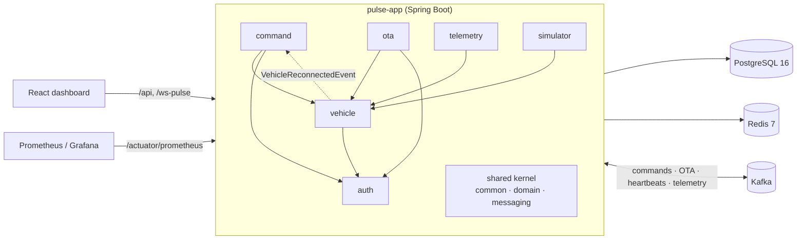

# Pulse — Connected Vehicle & Fleet OTA Platform

[](https://oracle.com/java/)
[](https://spring.io/projects/spring-boot)
[](https://spring.io/projects/spring-modulith)
[](https://react.dev/)
[](https://www.typescriptlang.org/)
[](https://vitejs.dev/)
[](https://kafka.apache.org/)
[](https://kubernetes.io/)
[](https://www.postgresql.org/)
[](https://redis.io/)
[](https://prometheus.io/)
[](https://grafana.com/)
[](https://github.com/basarsy/pulse/actions/workflows/ci.yml)

**Pulse** is a connected vehicle and fleet OTA update platform (BMW-inspired). It combines **Remote Vehicle Services** (real-time vehicle status and remote commands over asynchronous channels), **Fleet OTA Update Management** (software releases, staged canary rollouts, and automatic pausing when too many updates fail), **Telemetry & Observability** (vehicle health ingestion, audit logging, circuit breakers, Prometheus/Grafana), and a **Fleet Dashboard** built with React & TypeScript.

---

## 🏗️ Architecture: a modular monolith

Pulse is a single deployable Spring Boot application (`pulse-monolith`) organised into **domain modules**. Module boundaries are enforced by [Spring Modulith](https://spring.io/projects/spring-modulith): `ModularityTests` fails the build on dependency cycles between modules or on access to another module's internal packages.

| Module | Responsibility |
|---|---|
| `auth` | Users, roles, JWT issuance/validation, HTTP security configuration |
| `vehicle` | Vehicle registry, ownership & access policy, connectivity (heartbeats) |
| `command` | Remote command lifecycle, idempotency & rate limiting, Kafka dispatch, WebSocket push |
| `ota` | Software versions, staged rollout campaigns, per-vehicle update tracking |
| `telemetry` | Telemetry ingestion and history |
| `simulator` | Optional vehicle simulator (heartbeats, command/OTA execution, telemetry) |
| `common`, `domain`, `messaging`, `config` | Shared kernel: audit log, error handling, domain enums, Kafka topics & event payloads |
| `websocket` | STOMP broker configuration |

Each module owns its Kafka producers/consumers and WebSocket notifications. Where a dependency would point "backwards", modules communicate through Spring application events. For example, `vehicle` publishes `VehicleReconnectedEvent` and `command` flushes queued commands in response.



`mvn verify` also generates PlantUML diagrams of the actual module graph in `pulse-monolith/target/spring-modulith-docs`.

> An earlier iteration split the system into microservices (vehicle-registry, command, OTA, gateway). It was removed in favour of this modular monolith: the services duplicated most of the monolith's code and were never deployable end-to-end. The enforced module boundaries keep the option open to extract a service later.

---

## 🚀 Key Capabilities

- **Asynchronous Command Engine**: Remote commands (`LOCK`, `UNLOCK`, `REMOTE_START`, etc.) are queued and dispatched via Kafka, executed asynchronously by vehicles, and pushed in real time over STOMP WebSockets. Commands for offline vehicles are queued and flushed when the vehicle reconnects.
- **Fleet OTA Updates**: Staged canary rollouts (5% → 25% → 100%) with failure-rate monitoring that automatically pauses a rollout above a configurable threshold.
- **Telemetry Ingestion Pipeline**: Vehicle diagnostics (battery/fuel level, odometer, engine temperature, GPS) consumed from Kafka (`vehicle.telemetry`) and persisted in `telemetry_snapshots`.
- **Security**: Stateless JWT with separate access and refresh token types, role-based access control (`OWNER`, `FAMILY_MEMBER`, `DEALER_STAFF`, `FLEET_ADMIN`, `SYSTEM_ADMIN`), and per-vehicle authorization on every vehicle-scoped endpoint. Self-registration always creates an `OWNER`.
- **Idempotency & Rate Limiting**: Redis-backed, per-user idempotency keys and a fixed-window rate limit (10 commands/min, `429` when exceeded).
- **Fault Tolerance**: Resilience4j circuit breakers and exponential retries on Kafka dispatch.
- **Observability**: Asynchronous audit log, Micrometer domain metrics, Prometheus & Grafana.
- **Vehicle Simulator**: Mock ECU that emits heartbeats and telemetry and executes commands and OTA updates (enable with `SIMULATOR_ENABLED=true` or the `local` profile).
- **Kubernetes Ready**: Kustomize manifests for the app, dashboard, Postgres, Kafka, Redis, Prometheus, Grafana and an Nginx ingress; secrets are generated from a git-ignored env file.

---

## 📌 Development Roadmap & Progress

- [x] **Phase 0 — Project Setup & Baseline**
  - Spring Boot 3.3.5 scaffold & Java 21 baseline
  - Flyway database migrations
  - Infrastructure setup (`docker-compose.yml` with Postgres 16, Redis 7, Kafka in KRaft mode)
- [x] **Phase 1 — Auth & Vehicle Core**
  - User registration (`/api/v1/auth/register`) & login (`/api/v1/auth/login`) with BCrypt password hashing
  - Stateless JWT access and refresh tokens (`JwtService`, `JwtAuthenticationFilter`)
  - Role-Based Access Control
  - Vehicle registry CRUD & VIN uniqueness checks (`/api/v1/vehicles`)
  - SpEL method-security ownership and family member authorization (`/api/v1/vehicles/{id}/authorize`)
  - Fleet-wide vehicle management endpoint (`/api/v1/fleet/vehicles`)
- [x] **Phase 2 — Remote Command Engine**
  - Remote command state machine (`PENDING` -> `SENT` -> `ACKNOWLEDGED` -> `COMPLETED` / `FAILED` / `TIMED_OUT`)
  - Kafka command pipeline (`vehicle.commands` and `vehicle.command-results`)
  - Real-time STOMP WebSocket push channel (`/topic/vehicles/{vehicleId}/commands`)
  - Redis-backed idempotency tracking (24h TTL) and rate limiting (10 commands/min per user)
  - Scheduled command timeout job (`@Scheduled`)
- [x] **Phase 3 — OTA & Fleet Rollout Engine**
  - Software version package registry (`/api/v1/software-versions`)
  - Staged canary rollout campaign state machine (`DRAFT` -> `IN_PROGRESS` -> `PAUSED` -> `COMPLETED` / `ABORTED`)
  - Automated failure threshold monitoring with auto-pause
  - Per-vehicle update status lifecycle (`PENDING` -> `DOWNLOADING` -> `DOWNLOADED` -> `INSTALLING` -> `INSTALLED` / `FAILED` -> `ROLLED_BACK`)
  - Kafka OTA pipeline (`ota.vehicle-instructions` and `ota.vehicle-update-status`) and WebSocket progress streaming
- [x] **Phase 4 — Telemetry & Observability**
  - Telemetry ingestion (`/api/v1/vehicles/{id}/telemetry/latest`, `/history`) and Kafka consumer (`vehicle.telemetry`)
  - Resilience4j `@CircuitBreaker` and `@Retry` on the Kafka producers
  - Asynchronous audit logging (`AuditLogService`, JSONB metadata)
  - Micrometer domain metrics and Prometheus endpoint; Prometheus & Grafana in Docker Compose
- [x] **Phase 5 — Kubernetes & React Dashboard**
  - Kustomize manifests (`k8s/`) and the `pulse-dashboard` React 18 + Vite + TypeScript UI
- [x] **Phase 6 — Modular monolith consolidation & hardening**
  - Removed the microservices and the shared `pulse-common` jar; one deployable app
  - Domain modules verified by Spring Modulith (`ModularityTests`)
  - End-to-end `ApplicationSmokeTest` against real Postgres and Redis (Testcontainers) and embedded Kafka
  - Security fixes: no role escalation on sign-up, typed access/refresh tokens, per-vehicle command authorization, per-user idempotency keys, authenticated telemetry ingest, locked-down actuator
- [ ] **Next**
  - Wire the dashboard's vehicle, rollout and dashboard pages to the API (they currently show sample data) and use refresh tokens
  - Authenticate STOMP connections with the JWT and authorize topic subscriptions per vehicle
  - Transactional outbox for Kafka dispatch, dead-letter topics for consumers, optimistic locking on campaigns
  - Make the app safe to scale out: ShedLock for `@Scheduled` jobs and an external STOMP broker relay
  - Device authentication for vehicles (mTLS / device credentials)

---

## 🛠️ Tech Stack

- **Backend**: Java 21, Spring Boot 3.3.5, Spring Modulith 1.2
- **Frontend**: React 18, TypeScript 5, Vite 5, STOMP / SockJS
- **Security**: Spring Security, JJWT 0.12.6
- **Persistence**: Spring Data JPA, PostgreSQL 16, Flyway
- **Caching & Rate Limiting**: Redis 7, Spring Data Redis
- **Messaging**: Apache Kafka 3.7 (KRaft mode)
- **Fault Tolerance**: Resilience4j 2.2.0
- **Observability**: Micrometer, Spring Boot Actuator, Prometheus, Grafana
- **Testing**: JUnit 5, Mockito, Spring Modulith test, Testcontainers
- **Containerization & Orchestration**: Docker, Docker Compose, Kubernetes (Kustomize)
- **CI**: GitHub Actions (`.github/workflows/ci.yml`)

---

## 📁 Project Layout

```
pulse/
├── pom.xml                 # Parent POM (dependency management)
├── pulse-monolith/         # The application (all domain modules) + Dockerfile
├── pulse-dashboard/        # React dashboard + nginx image
├── k8s/                    # Kustomize manifests
├── docker-compose.yml      # Full local stack
└── prometheus.yml
```

---

## ⚙️ Getting Started

### Prerequisites

- Java 21+
- Node.js 20+
- Docker & Docker Compose

### Option A: everything in Docker

```bash
docker compose up --build
```

| Service | URL |
|---|---|
| Dashboard | http://localhost:3001 |
| API | http://localhost:8080/api/v1 |
| Prometheus | http://localhost:9090 |
| Grafana | http://localhost:3000 |

### Option B: app from your IDE / Maven, infrastructure in Docker

```bash
docker compose up -d postgres redis kafka
./mvnw -pl pulse-monolith spring-boot:run -Dspring-boot.run.profiles=local
```

The `local` profile provides a development JWT secret and enables the vehicle simulator. Outside that profile, `JWT_SECRET` (at least 32 bytes) is required.

Dashboard in dev mode (proxies `/api` and `/ws-pulse` to `localhost:8080`):

```bash
cd pulse-dashboard
npm install
npm run dev
```

### Tests

```bash
./mvnw verify
```

Runs unit tests, the Spring Modulith boundary verification and the Testcontainers smoke test (Docker required).

### Kubernetes

```bash
cp k8s/config/secrets.env.example k8s/config/secrets.env   # then set real values
kubectl apply -k k8s
```

---

## 📜 License

This project is open-source and available under the [MIT License](LICENSE).
